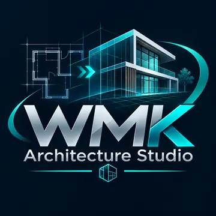

<p align="center"></p>

# WMK Architecture Studio

**Integração experimental CAD ↔ BIM para Windows, em português.**

**Autor da integração:** Walney Moreira Klein — walneyk@hotmail.com

Este repositório **não é um terceiro clone dos editores**. Ele integra, em etapas, dois projetos independentes:

- [WMK CAD Studio](https://github.com/WalneyNF/WMK-CAD-Studio): desenho técnico 2D, camadas, cotas, DXF/DWG.
- [WMK BIM Studio](https://github.com/WalneyNF/WMK-BIM-STUDIO): paredes, portas, janelas, pisos, telhados, modelos BIM e comandos `wall`.

## Por que integrar CAD, BIM e IA?

Um projeto arquitetônico passa por **desenhos técnicos, modelagem de elementos da construção, documentação e revisões**. Se cada aplicativo trabalha isoladamente, o profissional pode acabar repetindo paredes e cotas, perdendo informações em conversões e corrigindo arquivos manualmente.

- **CAD Studio:** produz geometria 2D precisa, camadas, cotas, blocos e DXF/DWG.
- **BIM Studio:** representa paredes, portas, janelas, pisos, telhados e demais elementos construtivos com propriedades.
- **Architecture Studio:** cria e valida a **ponte** entre as representações, controla unidades, registra o que foi convertido, exige revisão e futuramente integra OCR/IA para plantas rasterizadas.

**O terceiro programa não substitui os outros dois nem integra as interfaces ainda**. Seu papel inicial é converter e validar dados, preservando a independência dos motores.

### Pesquisa sobre as necessidades dos arquitetos

A revisão de fontes profissionais e acadêmicas de 2024–2026 identificou como temas prioritários: **precisão e interoperabilidade, redução de retrabalho, documentação, treinamento, custos e automação confiável**.

Confira a [pesquisa detalhada com evidências, tabela de necessidades por projeto, critérios de aceite e referências](pesquisa/necessidades-arquitetos-2026.md).

**Principais evidências:** o [CAU/BR](https://caubr.gov.br/pesquisa-bim-para-65-dos-profissionais-entidades-sao-referencia-em-inovacao/) divulgou grande demanda por capacitação tecnológica; a [AIA](https://www.aia.org/about-aia/press/new-aia-firm-survey-report-reveals-trends-shaping-business-architecture) documentou adoção crescente de IA nos escritórios dos EUA; e a [buildingSMART](https://www.buildingsmart.org/about/OpenBIM/) explica os padrões IFC, BCF e IDS para interoperabilidade.

**Esses resultados não substituem testes nem entrevistas com arquitetos brasileiros.** As funcionalidades propostas permanecem um backlog a validar.

## Importador de plantas v0.2 — já disponível no repositório

O módulo experimental **[importador/](importador/)** permite trabalhar com imagens **JPG/PNG** e com a **primeira página de PDFs**. Ele gera segmentos candidatos por OpenCV e exporta **DXF editável** após revisão humana.

- **Identidade WMK:** título, tela e ícone personalizados, arquivos de aplicação `wmk_architecture_studio.py` e `wmk_detector_planta.py`.
- **Reconhecimento:** detecção adaptativa de paredes laranja ou linhas escuras, com OCR opcional instalado separadamente.
- **Revisão:** linhas verdes ativas, clique para descartar em vermelho ou recuperar, opção de adicionar segmento manual.
- **Escala:** opção de calibrar com dois pontos e uma distância real conhecida em metros. Sem isso, unidade do DXF fica indefinida.
- **Saída:** DXF das linhas ativas, JSON com resultados e imagem de prévia; sem transformar o desenho automaticamente em uma construção validada.

### Como passar um DXF revisado para o BIM (experimento com escala confirmada)

O importador salva as linhas ativas na camada `WMK_PAREDES_REVISADAS`. **Antes do BIM, calibre a planta por uma medida real e confira o DXF no CAD.** Então, no diretório-raiz do Architecture Studio:

```powershell
py -3 bridge\dxf_para_bim.py "importador\projetos_gerados\planta\planta.dxf" "paredes-para-bim.txt" --camada WMK_PAREDES_REVISADAS --unidade mm
```

Substitua `planta` pelo nome da imagem importada. O conversor **recusa DXF do importador com unidade indefinida**. O resultado continua sendo apenas um **script de paredes candidatas de 100 mm para conferência**, não um projeto arquitetônico homologado. No WMK BIM Studio, teste primeiro o script num projeto de ensaio.

### Primeiro teste no Windows

```powershell
cd importador
.\iniciar-windows.bat
```

Requer Python 3.11+ e instala as bibliotecas Python num ambiente virtual. Consulte o [manual do importador](importador/README.md), seus [seis testes](importador/tests/test_detector.py) e a [compilação Windows experimental](../../actions).

**Limite importante:** o importador é uma aplicação de apoio dentro do repositório Architecture Studio; **não está embutido na interface do WMK CAD Studio**. Você gera DXF no importador e abre no CAD. Ele tampouco reconhece todas as paredes/portas automaticamente ou gera BIM 3D pronto.

## O que funciona neste primeiro experimento

O arquivo `bridge/dxf_para_bim.py` (a ser mantido neste repositório) recebe um **DXF ASCII de teste** contendo linhas na camada **WMK_PAREDES** e gera um script de paredes que poderá ser executado no WMK BIM Studio. O conversor utiliza **apenas a biblioteca padrão do Python**, sem servidor e sem API de IA.

**Não confundir com integração completa:** este primeiro experimento não transforma automaticamente uma imagem em BIM, não detecta portas/janelas, nem sincroniza alterações entre aplicativos. É um teste de intercâmbio de geometria, com validação humana.

### Experimento no Windows

1. No WMK CAD Studio, desenhe segmentos na camada `WMK_PAREDES` em unidades de **milímetros**; exporte em formato **DXF ASCII**.
2. Abra o PowerShell na pasta deste repositório.
3. Execute:
   ```powershell
   py -3 bridge\dxf_para_bim.py entrada.dxf saida.wmk.txt --unidade mm
   ```
4. No WMK BIM Studio, abra um projeto de teste, entre em **Gerenciar → Executar script**, cole as linhas do arquivo TXT, clique em **Testar** e depois em **Executar** se o resultado estiver correto.
5. Confira a posição das paredes na vista 2D e 3D.

Para testar sem desenhar nada, use o DXF de exemplo incluso:
```powershell
py -3 bridge\dxf_para_bim.py exemplos\quarto.dxf paredes.wmk.txt --unidade mm
py -3 -m unittest discover -s tests -v
```

### Segurança e limitações

- O conversor só importa entidades `LINE` na camada `WMK_PAREDES`; outros elementos são ignorados.
- A unidade deve ser informada explicitamente (mm/m). O DXF pode ser exportado em outras unidades; confira.
- Paredes recebem tipo inicial `Interior - 100mm`, que é uma hipótese para ensaio, **não um dimensionamento profissional**.
- O script é gerado localmente, sem modificar o projeto automaticamente.
- Nunca execute scripts importados em um projeto importante sem conferir a origem e usar o botão **Testar**.

## Arquitetura proposta

```text
[WMK CAD Studio] --DXF--> [Bridge: validação + conversão] --script--> [WMK BIM Studio]
                                       ^
                          [OCR / IA, em fase posterior]
```

**Princípio:** manter os motores CAD e BIM em seus repositórios. O Architecture Studio controla formatos intermediários, testes, documentação, troca de dados e, só após validação, uma interface unificada.

## Próximas entregas

Veja [ROADMAP.md](ROADMAP.md). Prioridade: testar a conversão real de DXF em paredes do WMK BIM Studio antes de adicionar OCR/IA.

## Créditos e licenças

Integração original: **Walney Moreira Klein — walneyk@hotmail.com**. CADCraft e BIMCraft mantêm seus autores e licenças originais. Nenhum código do motor de terceiros é copiado neste projeto nesta fase.